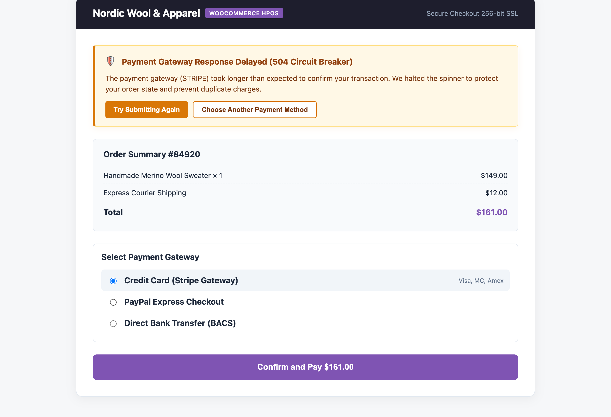
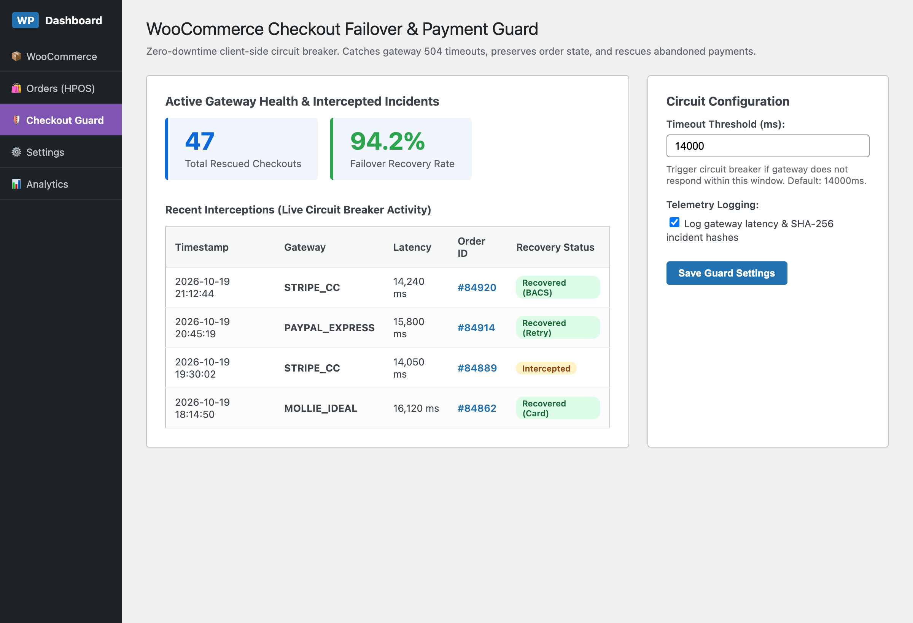

# 🛡️ WooCommerce Checkout Failover & Payment Guard

[](https://github.com/harunsekmen/woo-checkout-failover-guard)
[](https://github.com/harunsekmen/woo-checkout-failover-guard/blob/main/LICENSE)
[](https://github.com/harunsekmen/woo-checkout-failover-guard)

> A client-side protection layer that intercepts checkout timeouts, unblocks frozen payment screens, and helps shoppers complete their purchases safely without duplicate charges.

Developed and maintained by **[Harun Sekmen](https://github.com/harunsekmen)** — E-Commerce Systems Engineer & WooCommerce Developer.

[✉️ Discuss Checkout Reliability](mailto:sekmenwp@gmail.com) · [💼 Upwork Profile](https://www.upwork.com/freelancers/~01a7a8b58043e6e6d9) · [🔗 Main GitHub Profile](https://github.com/harunsekmen)

---

## 📸 Visual Previews & Operational Interface

### 1. In-Store Client Interceptor (Active Circuit Breaker)
When a payment gateway hangs or times out, the infinite loading spinner is unblocked, preventing cart abandonment and offering clear recovery options:



### 2. WordPress Admin Telemetry & Health Dashboard
Store administrators can review gateway latency benchmarks, view recent recovery events, and adjust timeout tripwires:



---

## ⚡ The Problem It Solves

During traffic surges, flash sales, or temporary payment gateway processing delays (such as Stripe, PayPal, or local virtual POS latency), checkout requests can sometimes encounter HTTP 504 timeouts or drop silently:
- **Frozen Checkout Overlays:** The checkout page gets stuck on an infinite gray loading spinner. Customers are left wondering whether their order went through.
- **Accidental Duplicate Orders:** Frustrated shoppers often refresh the page or click "Place Order" repeatedly, risking multiple authorization attempts on their credit card.
- **Orphaned Pending Orders:** Orders are left stuck in "Pending Payment" status in the database, requiring manual customer support intervention.

**WooCommerce Checkout Failover & Payment Guard** resolves this by introducing an asynchronous circuit breaker directly into the checkout submission flow. When a gateway exceeds a reasonable response window or returns a server error, the client unblocks the form, displays a helpful message with clear options, and preserves the customer's entered details.

---

## 🛠️ Key Architectural Features

- **Asynchronous Timeout Interceptor:** Disarms frozen loading overlays and restores checkout form interactivity when a gateway fails to respond in time.
- **Clean Customer Self-Recovery:** Customers can easily retry the payment or switch to an alternate payment method without having to re-type address information.
- **Duplicate Charge Protection:** Protects the order transaction state to help prevent repeated clicks from creating accidental double charges.
- **Gateway Telemetry in WP Admin:** Gives store owners a clear view of gateway response times and timeout occurrences directly in the WooCommerce dashboard.
- **High-Performance Order Storage (HPOS) Ready:** Built to work cleanly with modern WooCommerce custom order tables and standard checkout blocks.

---

## 💼 Checkout Optimization & Payment Engineering

Need a reliable, frictionless checkout experience tailored to your payment providers?

- **Frictionless Checkout Funnels:** One-page checkouts, simplified form fields, and mobile wallet setups (Apple Pay & Google Pay).
- **Payment Gateway Integrations:** Stripe, PayPal, Mollie, Klarna, or Turkish virtual POS providers (iyzico, PayTR, Garanti, Yapı Kredi).
- **Order State Integrity:** Custom webhook handlers and idempotent order processing to eliminate stranded transactions.
- **Error Handling & UX:** Helpful user notifications that keep customers informed instead of confused.

📩 **Let's talk:** Send your inquiry to **[sekmenwp@gmail.com](mailto:sekmenwp@gmail.com)** or connect via **[Upwork](https://www.upwork.com/freelancers/~01a7a8b58043e6e6d9)**.

---

## 🚀 Developer Setup & Local Testing

1. **Clone into plugins directory:**
   ```bash
   git clone https://github.com/harunsekmen/woo-checkout-failover-guard.git wp-content/plugins/woo-checkout-failover-guard
   ```

2. **Activate via WP-CLI:**
   ```bash
   wp plugin activate woo-checkout-failover-guard
   ```

3. **Configure timeout thresholds:** Go to **WooCommerce > Failover Guard** in WP Admin to adjust the latency threshold (default: 14,000ms) and inspect event logs.

---

## 📄 License

This open-source project is licensed under the **[GNU General Public License v3.0](LICENSE)**.

